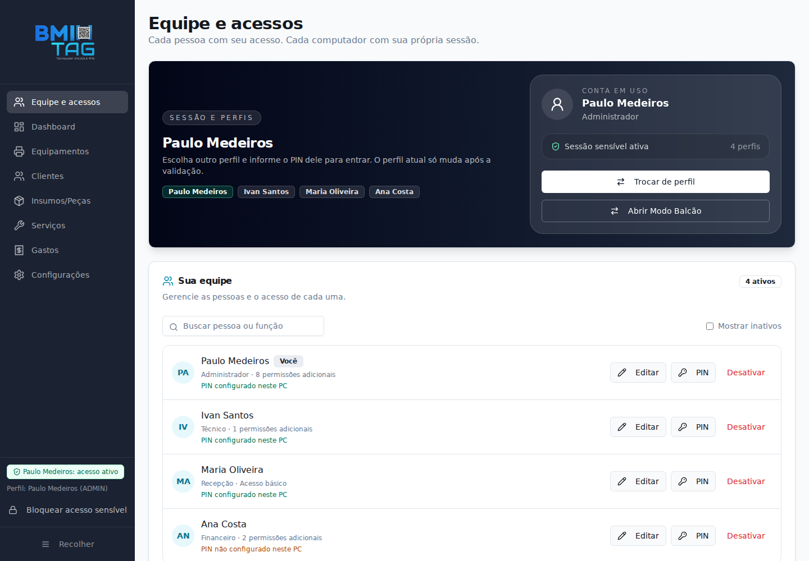
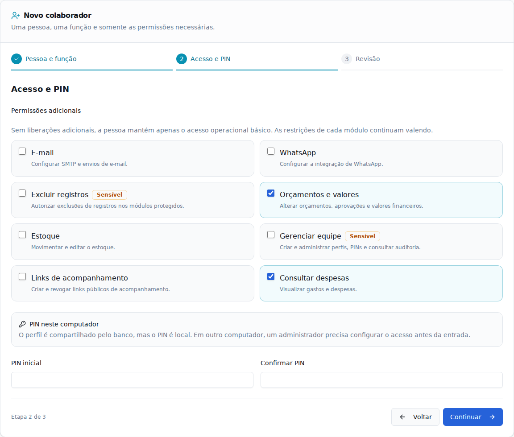
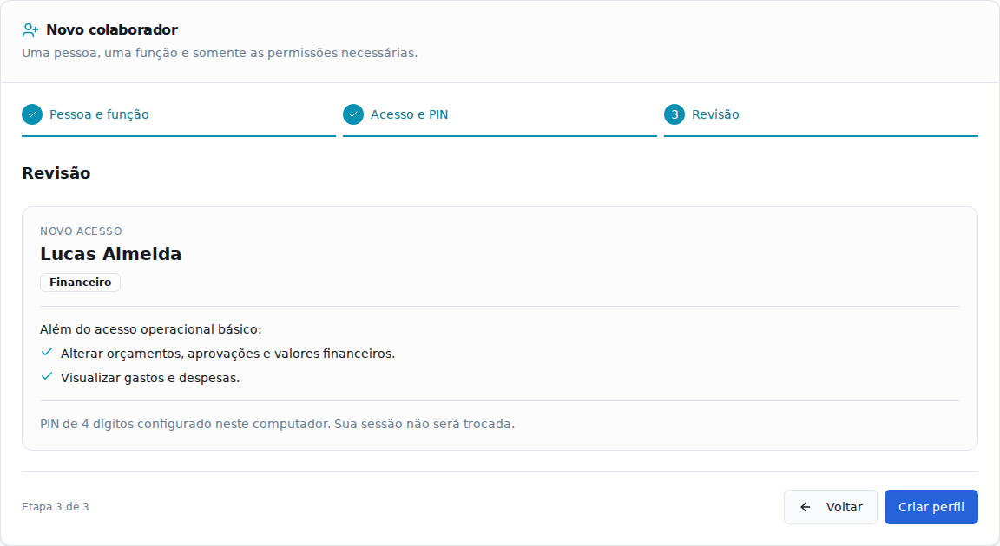

# Equipe e acessos

A rota `/perfil` reúne a equipe, o cadastro guiado e as ações administrativas de edição, configuração de PIN local, desativação e reativação. A tela de Segurança não repete essa gestão: mostra um resumo da equipe com atalho para Equipe e acessos e mantém só o que não existe aqui, o bloqueio por inatividade e a exclusão permanente de perfil, com verificação dupla.

## Cadastro

1. Identifique a pessoa pelo nome e selecione uma função inicial.
2. Ajuste permissões adicionais e configure um PIN de 4 a 8 dígitos neste computador.
3. Revise o resumo e confirme. O cadastro não troca a sessão de quem está administrando.

| Modelo | Permissões adicionais iniciais |
| --- | --- |
| Recepção | Acessos do portal |
| Técnico | Estoque, elaborar e enviar orçamentos e acessos do portal |
| Financeiro | Ações financeiras, elaborar e enviar orçamentos, consulta de despesas e acessos do portal |
| Administrador | Todas as permissões sensíveis existentes |
| Personalizado | Nenhuma; escolha as liberações individualmente |

Os modelos não criam verificações novas nos módulos: aplicam as permissões já fiscalizadas pelo backend. Ajustar uma permissão transforma a função em Personalizado. O acesso básico não é um modo de leitura: mantém as operações comuns já permitidas pelo AutoOS.

## Elaborar e enviar orçamentos

A permissão `PREPARE_QUOTES` ("Elaborar e enviar orçamentos") é sensível. A migration `0042` é só de dados: adiciona essa permissão apenas ao perfil Administrador já existente, sem alterar o schema. A migration de dados `0048` concede a permissão aos perfis de role `TECNICO`/`FINANCEIRO` e aos perfis existentes de nome Técnico/Tecnico/Financeiro, inclusive inativos, sem duplicar permissões. Financeiro também precisa dela: `FINANCIAL_ACTIONS` cobre valores e decisões, mas publicar e enviar orçamento exigem `PREPARE_QUOTES` ou `MANAGE_STATUS_LINKS`.

Com a permissão, a pessoa pode:

- finalizar a verificação com orçamento;
- editar o orçamento enquanto ele não estiver decidido (RECEBIDO, EM_VERIFICACAO, VERIFICADO ou AGUARDANDO_APROVACAO);
- prorrogar o prazo de aprovação;
- publicar o orçamento no portal;
- enviar o orçamento ao contato destinatário. Se esse contato ainda não tem senha do portal, o envio cria a senha inicial dele, sem que a pessoa a digite. Quem não tinha acesso passa a só acompanhar; esse caminho nunca cria quem decide.

Não libera:

- aprovar, reprovar, marcar o orçamento como vencido, entregar ou abandonar a OS;
- alterar o valor final;
- configurar SMTP ou WhatsApp;
- definir senha manual do portal do cliente;
- editar o acesso dos contatos.

## Comunicação externa e acessos do portal (0049)

| Antes | Depois | Escopo |
| --- | --- | --- |
| `CONFIG_SMTP` | `COMMUNICATION_SETTINGS` — Comunicação externa | SMTP, WhatsApp e ligar/desligar o portal |
| `CONFIG_WHATSAPP` | `COMMUNICATION_SETTINGS` — Comunicação externa | Mesma liberação, sem separação por canal |
| `MANAGE_STATUS_LINKS` — Portal do Cliente e links | `MANAGE_STATUS_LINKS` — Acessos do portal | Enviar links, criar/redefinir senhas e acessos de contatos, publicar orçamento e editar o contato público da empresa; não liga/desliga o portal |

A migration **0049** é somente de dados e idempotente: quem tinha SMTP **ou** WhatsApp recebe Comunicação externa, com remoção das chaves antigas e duplicatas. Quem tinha apenas `MANAGE_STATUS_LINKS` mantém seus acessos, sem ganhar Comunicação externa. A contagem de promoção passa a 46. A 0049 vem depois da 0048 do #184; 0045/0046 pertencem ao portal na `feature` e 0047 está reservada ao PDF oficial. São **46 arquivos**, não 49.

Recepção, Técnico e Financeiro recebem **Acessos do portal nos modelos de novos cadastros**; permissões de perfis existentes só mudam pelo mapeamento acima. Financeiro ganha acesso operacional ao portal para gerenciar contatos, senhas e links, além de continuar preparando e decidindo orçamentos. Administrador continua com tudo. Personalizado pode ficar sem permissões. O envio/publicação por `PREPARE_QUOTES` continua permitido nos fluxos de orçamento, sem conceder configuração de comunicação.

Conceder acesso `DECIDIR` ou redefinir manualmente a senha de quem decide continua exigindo a permissão financeira. Alterar “Clientes podem responder orçamentos” exige **Comunicação externa e Ações financeiras**; ligar/desligar somente o portal exige apenas Comunicação externa. Negativas e mudanças continuam auditadas pelo backend.

**Distribuição coordenada:** a 0.6.2 não conhece `COMMUNICATION_SETTINGS`. Depois da 0049, um perfil não-administrador com essa chave pode impedir que clientes antigos listem perfis; o build novo, por sua vez, exige o mapeamento das chaves antigas para listar esses perfis. Paulo deve coordenar a distribuição do build e a execução da 0049 em uma janela de manutenção, com os PCs fechados até concluir ambos. Não integrar o PR nem executar a migration enquanto houver frota mista. Este PR é empilhado sobre o da 0048 e deve ser integrado depois dele; a ordem de merge/migration continua sendo do Paulo.

## Avatar: somente formas

O seletor compartilhado entre primeiro acesso e personalização oferece apenas nove formas. A 0049 troca qualquer ícone antigo salvo por `AVATAR_SHAPES[abs(id) % 9]`, preservando a forma já escolhida, a cor e o tema. `profileAppearance` usa o mesmo cálculo para valores ausentes ou antigos. O backend aceita apenas as nove formas; os ícones antigos não podem ser gravados novamente. O rótulo passa de “Ou uma forma” para **Forma**.

Verificações adicionais (PostgreSQL local descartável): `scripts/tests/communication-appearance-migration.sql` testa o mapeamento de permissões/avatares e idempotência; `test_communication_permissions` testa o comando real, as permissões financeira/comunicação e a auditoria. Forneça `AUTOOS_STOCK_TEST_DATABASE_URL` de um banco **local** `autoos_stock_test*` com as migrations aplicadas.

## Transição da 0.5.6 para a 0.6.0

A 0.5.6 recusa, ao montar a lista de perfis, qualquer perfil não-administrador que (a) não tenha nenhuma permissão ("Selecione ao menos uma permissão para o perfil") ou (b) contenha uma chave que ela não conhece, como `PREPARE_QUOTES` ou `MANAGE_STATUS_LINKS` ("Permissão inválida"). Um único perfil assim deixa a lista vazia e ninguém entra nos PCs que ainda estão na 0.5.6. O Administrador não é afetado, pois recebe todas as permissões sem ler a coluna. A 0.5.6 conhece só: `CONFIG_SMTP`, `CONFIG_WHATSAPP`, `DELETE_RECORDS`, `FINANCIAL_ACTIONS`, `STOCK_CONTROL`, `MANAGE_PROFILES` e `VIEW_EXPENSES`.

- A 0042 concede `PREPARE_QUOTES` só ao Administrador.
- **Transição concluída em 10/11/2026:** Paulo confirmou todos os PCs na **0.6.2**. `COMPATIBILIDADE_056_ATIVA` está desligada no Rust e no frontend, e `PREPARE_QUOTES_NOS_MODELOS` está ligada.
- A migration de dados **0048** concede `PREPARE_QUOTES` a Técnico e Financeiro. A numeração reserva 0045/0046 para o portal na `feature` e 0047 para o PDF oficial; 0048 e 0049 ficam para #184 e #185.
- Recepção (`ATENDENTE`) voltou a estar disponível no cadastro com a 0048, inclusive sem permissões; a 0049 adiciona Acessos do portal ao modelo para novos cadastros. Todas as permissões do perfil também aparecem na criação, incluindo **Elaborar e enviar orçamentos** e **Acessos do portal**.
- **Impacto:** depois da concessão, PCs na 0.5.6 deixam de listar os perfis. Não há mais PCs nessa versão, conforme confirmação do Paulo; não voltar a distribuir a 0.5.6 nem religar a trava.
- **Pós-merge, por ordem do Paulo:** acompanhar o workflow de migrations; confirmar a 0048 e a contagem de 45 migrations; validar Técnico criando/enviando orçamento, Recepção sem permissões e a lista completa de permissões no cadastro. Este PR não executa migrations em produção nem cria release/tag.

## Sessão e autenticação

Ao aceitar um PIN, o seletor mantém o campo com o cadeadinho verde até fechar. Fechar ou reabrir a confirmação durante essa animação conclui apenas o pedido já aceito e cancela seu temporizador; um pedido novo continua exigindo sua própria confirmação. Com movimento reduzido, o fechamento é imediato.

- A pessoa e suas permissões continuam no PostgreSQL compartilhado.
- O PIN e seu hash permanecem no cofre do sistema operacional. Não são sincronizados entre computadores.
- A migration `0030` adiciona somente a política `pin_required`. Um perfil protegido sem segredo local fica bloqueado; ausência do cofre não equivale a autorização para entrar sem PIN.
- Um administrador autenticado naquele PC pode configurar o PIN do colaborador em Equipe e acessos. Se nenhum administrador tiver PIN local, use a recuperação existente com credenciais PostgreSQL.
- A exceção de primeiro acesso é apenas o administrador inicial sem histórico de segurança e com um único perfil. Configurar o primeiro PIN marca a identidade como protegida. O comando de desbloqueio sem PIN não libera administradores.
- Perfis existentes passam a exigir PIN na migration. Perfis antigos intencionalmente sem PIN precisam de provisionamento administrativo; a API ainda aceita criação explicitamente sem PIN para perfis não administrativos por compatibilidade.
- A seleção ativa é mantida na memória desta instância, inclusive após bloquear a sessão. Trocar de pessoa não altera `is_default` nem `atualizado_em` no banco compartilhado. Ao reiniciar, a interface pré-seleciona o último perfil daquele navegador/WebView e pede autenticação.

Esta alteração não implementa uma conta central com credencial única entre PCs. Antes de distribuir em produção, valide a migration em homologação e atualize todos os computadores: versões anteriores não fiscalizam `pin_required`.

## Verificação

- `npm run lint`
- `npm run test:run`
- `npm run build`
- `node scripts/check-sqlx-migrations.mjs`
- `node scripts/verify-team-ui.mjs` (Chromium do Playwright instalado; opcionalmente `AUTOOS_PREVIEW_BROWSER` aponta para um executável compatível)
- `cargo check --manifest-path src-tauri/Cargo.toml`
- `cargo test --manifest-path src-tauri/Cargo.toml --bin autoos`
- Integração PostgreSQL/cofre: `test_auth_integration` e `test_auth_optional_pin`, apenas em banco de testes.

O script de interface inicia seu próprio Vite com IPC simulado, cadastra, revisa, edita, configura PIN, desativa/reativa e verifica o layout de 390 px. As capturas em `docs/previews/` usam dados fictícios. A verificação de navegador não substitui a integração nativa com PostgreSQL e o cofre.

## Prévia

## Reset de PIN por outro administrador (F-5)

A decisão é manter o bloqueio de perfis protegidos quando o PIN não existe no cofre deste computador. Ter acesso em outro PC não provisiona este automaticamente.

1. No computador em que o colaborador está bloqueado, selecione **outro administrador com PIN já configurado neste PC** e autentique-se com o PIN dele.
2. Abra **Equipe e acessos**, localize o colaborador e clique em **PIN**.
3. Digite um novo PIN de 4 a 8 dígitos e repita em **Confirmar novo PIN**.
4. Em **Seu PIN de administrador**, informe o PIN do administrador que está autenticado. Confirme a alteração.
5. Aguarde a confirmação de sucesso e o indicador **PIN configurado neste PC**. Use **Trocar de perfil** e entre como o colaborador com o novo PIN.

O reset preserva as permissões, é registrado na auditoria e altera apenas o segredo local deste PC. Se não houver nenhum administrador com PIN local, use **Esqueci minha senha** na entrada e a recuperação existente com credenciais PostgreSQL autorizadas; não remova `pin_required` nem habilite entrada sem PIN como atalho. O primeiro cadastro de uma instalação vazia continua seguindo a exceção de bootstrap já documentada acima.

## Numeração entre master e feature (10/11/2026)

Este build da linha interna contém 0001–0044, 0047 (PDF oficial do portal, #188), 0048 (#184) e 0049 (#185), com 47 arquivos. Não criar arquivos vazios para preencher 0045/0046: pertencem ao portal na `feature`. Os verificadores de arquivos e de promoção aceitam somente essas lacunas reservadas, preservando a verificação de duplicatas, demais ausências e contagem real. A lista de reservas fica em um único arquivo, `scripts/sqlx-reserved-migrations.txt`, lido por `check-sqlx-migrations.mjs`, `verify-estoque-seed.sh` (job QA Real) e `production_migrate.rs`; alterar a reserva é alterar só esse arquivo. O verificador de histórico exige cada versão presente nos arquivos do build, sem inventar versões ausentes dele.

No sync semanal **master → feature**, preservar as migrations 0045/0046 da `feature` e os arquivos vindos da `master`, sem renumerar migrations aplicadas. Reconciliar a união de `REQUIRED_PROMOTION_MIGRATIONS` e atualizar `EXPECTED_MIGRATION_COUNT` pelo número de arquivos, não pelo maior ID: após PDF + #184 + #185, 47 arquivos na `master` (0001–0044, 0047–0049) e 49 na `feature` (0001–0049). Rodar `node scripts/check-sqlx-migrations.mjs`, `cargo test --manifest-path src-tauri/Cargo.toml --bin production_migrate`, `npm run build:saas` e `npm run test:run` na `feature`. Nenhum merge nem aplicação em produção faz parte desta correção.
