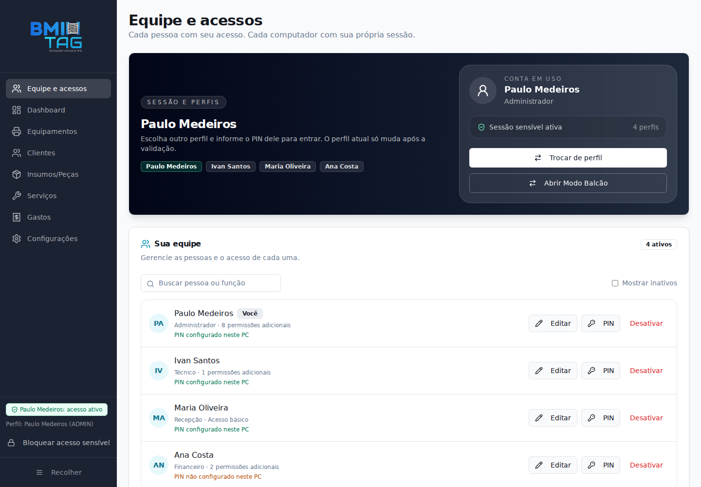
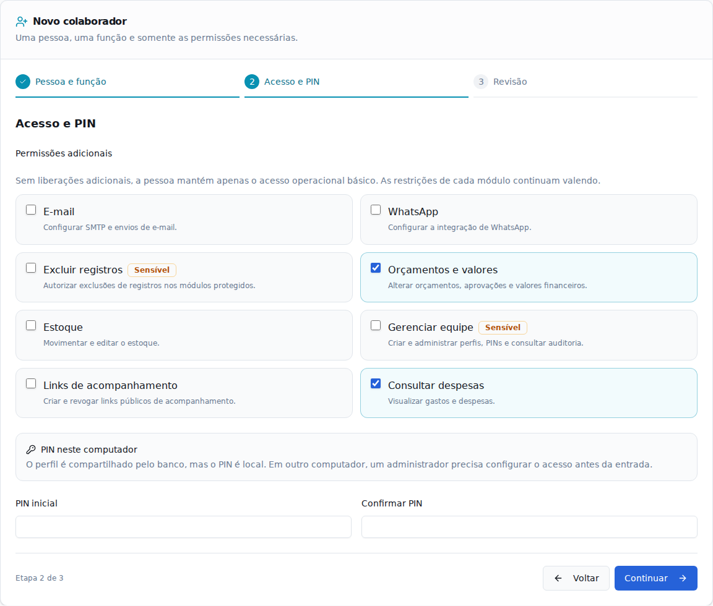
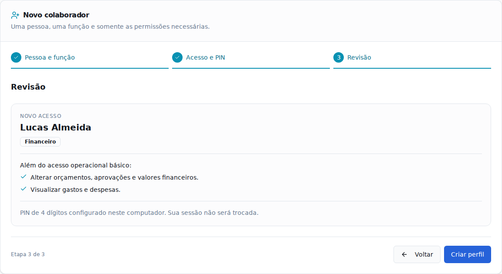

# Equipe e acessos

A rota `/perfil` reúne a equipe, o cadastro guiado e as ações administrativas de edição, configuração de PIN local, desativação e reativação. A tela de Segurança não repete essa gestão: mostra um resumo da equipe com atalho para Equipe e acessos e mantém só o que não existe aqui, o bloqueio por inatividade e a exclusão permanente de perfil, com verificação dupla.

## Cadastro

1. Identifique a pessoa pelo nome e selecione uma função inicial.
2. Ajuste permissões adicionais e configure um PIN de 4 a 8 dígitos neste computador.
3. Revise o resumo e confirme. O cadastro não troca a sessão de quem está administrando.

| Modelo | Permissões adicionais iniciais |
| --- | --- |
| Recepção | Nenhuma |
| Técnico | Estoque (elaborar e enviar orçamentos após a transição para a 0.6.0) |
| Financeiro | Ações financeiras e consulta de despesas (elaborar e enviar orçamentos após a transição para a 0.6.0) |
| Administrador | Todas as permissões sensíveis existentes |
| Personalizado | Nenhuma; escolha as liberações individualmente |

Os modelos não criam verificações novas nos módulos: aplicam as permissões já fiscalizadas pelo backend. Ajustar uma permissão transforma a função em Personalizado. O acesso básico não é um modo de leitura: mantém as operações comuns já permitidas pelo AutoOS.

## Elaborar e enviar orçamentos

A permissão `PREPARE_QUOTES` ("Elaborar e enviar orçamentos") é sensível. A migration `0042` é só de dados: adiciona essa permissão apenas ao perfil Administrador já existente, sem alterar o schema. Técnico e Financeiro a recebem em uma migration posterior (ainda não criada); veja "Transição da 0.5.6 para a 0.6.0".

Com a permissão, a pessoa pode:

- finalizar a verificação com orçamento;
- editar o orçamento enquanto ele não estiver decidido (RECEBIDO, EM_VERIFICACAO, VERIFICADO ou AGUARDANDO_APROVACAO);
- prorrogar o prazo de aprovação;
- publicar o orçamento no portal;
- enviar o orçamento ao contato destinatário. Se esse contato ainda não tem senha do portal, o envio cria a senha inicial dele, sem que a pessoa a digite. Quem não tinha acesso passa a só acompanhar; esse caminho nunca cria quem decide.

Não libera:

- aprovar, reprovar, marcar o orçamento como vencido, entregar ou abandonar a OS;
- alterar o valor final;
- configurar SMTP ou WhatsApp;
- definir senha manual do portal do cliente;
- editar o acesso dos contatos.

## Transição da 0.5.6 para a 0.6.0

A 0.5.6 devolve "Permissão inválida" para perfil não-administrador que contenha uma chave de permissão desconhecida, como `PREPARE_QUOTES`. Isso quebra a tela de perfis e o desbloqueio nos PCs que ainda estão na 0.5.6. O Administrador não é afetado, pois recebe todas as permissões sem ler a coluna.

- A 0042 concede `PREPARE_QUOTES` só ao Administrador.
- Técnico e Financeiro recebem a permissão em migration posterior (ainda não criada), aplicada quando todos os PCs estiverem na 0.6.0. Nesse momento, `PREPARE_QUOTES_NOS_MODELOS` em `src/lib/profile-presets.ts` passa a `true`.
- Enquanto isso, NÃO marque "Elaborar e enviar orçamentos" em perfis não-administradores com o build novo: os PCs na 0.5.6 recusam o perfil e quebram a tela de perfis e o desbloqueio.

## Sessão e autenticação

- A pessoa e suas permissões continuam no PostgreSQL compartilhado.
- O PIN e seu hash permanecem no cofre do sistema operacional. Não são sincronizados entre computadores.
- A migration `0030` adiciona somente a política `pin_required`. Um perfil protegido sem segredo local fica bloqueado; ausência do cofre não equivale a autorização para entrar sem PIN.
- Um administrador autenticado naquele PC pode configurar o PIN do colaborador em Equipe e acessos. Se nenhum administrador tiver PIN local, use a recuperação existente com credenciais PostgreSQL.
- A exceção de primeiro acesso é apenas o administrador inicial sem histórico de segurança e com um único perfil. Configurar o primeiro PIN marca a identidade como protegida. O comando de desbloqueio sem PIN não libera administradores.
- Perfis existentes passam a exigir PIN na migration. Perfis antigos intencionalmente sem PIN precisam de provisionamento administrativo; a API ainda aceita criação explicitamente sem PIN para perfis não administrativos por compatibilidade.
- A seleção ativa é mantida na memória desta instância, inclusive após bloquear a sessão. Trocar de pessoa não altera `is_default` nem `atualizado_em` no banco compartilhado. Ao reiniciar, a interface pré-seleciona o último perfil daquele navegador/WebView e pede autenticação.

Esta alteração não implementa uma conta central com credencial única entre PCs. Antes de distribuir em produção, valide a migration em homologação e atualize todos os computadores: versões anteriores não fiscalizam `pin_required`.

## Verificação

- `npm run lint`
- `npm run test:run`
- `npm run build`
- `node scripts/check-sqlx-migrations.mjs`
- `node scripts/verify-team-ui.mjs` (Chromium do Playwright instalado; opcionalmente `AUTOOS_PREVIEW_BROWSER` aponta para um executável compatível)
- `cargo check --manifest-path src-tauri/Cargo.toml`
- `cargo test --manifest-path src-tauri/Cargo.toml --bin autoos`
- Integração PostgreSQL/cofre: `test_auth_integration` e `test_auth_optional_pin`, apenas em banco de testes.

O script de interface inicia seu próprio Vite com IPC simulado, cadastra, revisa, edita, configura PIN, desativa/reativa e verifica o layout de 390 px. As capturas em `docs/previews/` usam dados fictícios. A verificação de navegador não substitui a integração nativa com PostgreSQL e o cofre.

## Prévia

## Reset de PIN por outro administrador (F-5)

A decisão é manter o bloqueio de perfis protegidos quando o PIN não existe no cofre deste computador. Ter acesso em outro PC não provisiona este automaticamente.

1. No computador em que o colaborador está bloqueado, selecione **outro administrador com PIN já configurado neste PC** e autentique-se com o PIN dele.
2. Abra **Equipe e acessos**, localize o colaborador e clique em **PIN**.
3. Digite um novo PIN de 4 a 8 dígitos e repita em **Confirmar novo PIN**.
4. Em **Seu PIN de administrador**, informe o PIN do administrador que está autenticado. Confirme a alteração.
5. Aguarde a confirmação de sucesso e o indicador **PIN configurado neste PC**. Use **Trocar de perfil** e entre como o colaborador com o novo PIN.

O reset preserva as permissões, é registrado na auditoria e altera apenas o segredo local deste PC. Se não houver nenhum administrador com PIN local, use **Esqueci minha senha** na entrada e a recuperação existente com credenciais PostgreSQL autorizadas; não remova `pin_required` nem habilite entrada sem PIN como atalho. O primeiro cadastro de uma instalação vazia continua seguindo a exceção de bootstrap já documentada acima.
